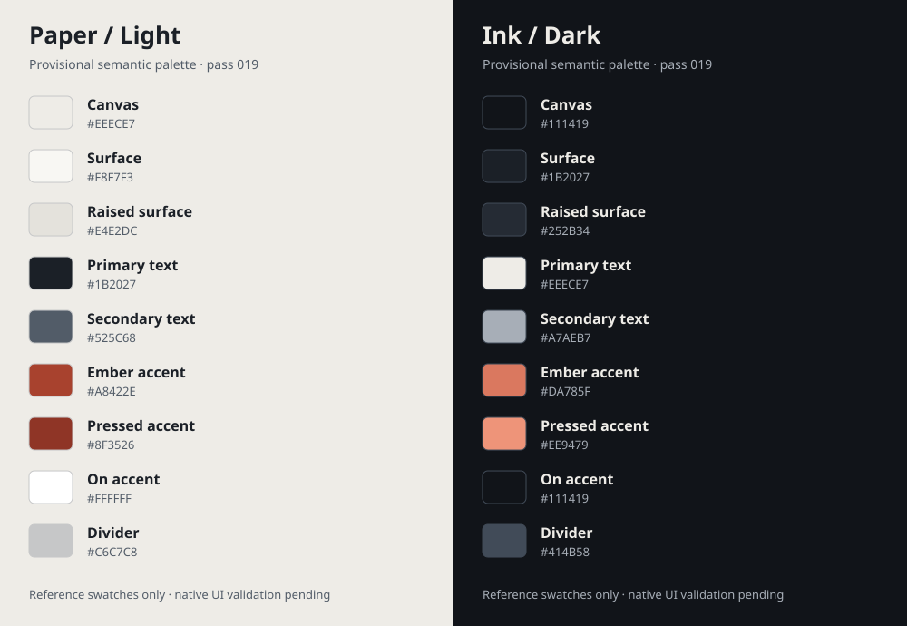

# Visual foundation — pass 019

## UI audit recorded before implementation

Reviewed the SwiftUI app/root lifecycle, all four tabs, Search and Library rows/filters, dashboard rows/read states, movie/TV detail sections/artwork, rating controls, diary/review editors/history, TV season/progress screens, Settings/Credits, backup preview/document pickers, and the image view's presentation boundary.

- `AppStyle` only defines system grouped background/surface and 8/16/24 spacing. There is no shared accent, text hierarchy, divider or shape vocabulary.
- System fonts already support Dynamic Type, but repeated `.headline`, `.title.bold()`, `.subheadline` and `.footnote` choices do not express consistent page/media/metadata roles.
- 4/6/8/12/16-point spacing and 6/8/12/16-point radii appear locally. Search and Library independently implement the same 56×84 poster shape/fallback, while detail posters use the same larger radius as backdrops.
- Media-type labels are plain metadata in some rows and heavier text in detail headers. Empty states mix `ContentUnavailableView`, a shared card and local stacks. Loading/retry states repeat presentation directly in feature views.
- Native NavigationStack/TabView, List/Form, segmented/menu filters, menu/stepper ratings, confirmation dialogs and accessibility identifiers are functioning foundations to preserve. Existing accessibility-size vertical Library rows, menu filter fallbacks, wrapping text and descriptive artwork labels should remain.
- Existing colors are semantic system colors and have no intentional warm/cinematic identity. Supplied app icon/third-party attribution artwork are already separate assets and will not be redrawn or recolored.

This is a source audit, not a screenshot/device evaluation. Business logic, persistence, providers, image loading/cache behavior, ratings, reviews, progress and backup/restore are outside the change scope.

## Design direction and application plan

Frame artwork with quiet warm light surfaces / deep charcoal dark surfaces. Use one warm Ember accent adjusted for readable contrast, system SF typography, a 4-point spacing grid and smaller poster rounding than content containers. Keep native navigation and control semantics. No gradients, glow, shadows, glass effects, custom gestures, custom fonts or decorative animation.

Introduce tokens and genuinely shared presentation components, then demonstrate them in existing rows, detail sections and selected state/action views. Retain screen composition, destinations, labels/actions and native editor/picker flows. Broader feature-screen redesign remains a later pass.

## Tokens and rationale

Nine named sRGB color assets each include default light, dark, increased-contrast light and increased-contrast dark variants. The supplied app icon and TMDB logo are unchanged. Ember is provisional UI emphasis per the prompt, not a new logo/brand rollout. Native warning/destructive semantics retain their platform roles rather than introducing competing decorative accents.

| Semantic role / AppStyle.Colors | Light | Dark | Increased-contrast light / dark |
| --- | --- | --- | --- |
| canvas | `#EEECE7` Paper | `#111419` Ink | `#EEECE7` / `#0D1014` |
| surface | `#F8F7F3` | `#1B2027` | `#FFFFFF` / `#151A21` |
| raisedSurface | `#E4E2DC` | `#252B34` Slate | `#E4E2DC` / `#202630` |
| primaryText | `#1B2027` | `#EEECE7` | `#111419` / `#FFFFFF` |
| secondaryText | `#525C68` | `#A7AEB7` | `#3D4651` / `#CBD1D9` |
| accent | `#A8422E` | `#DA785F` | `#903725` / `#DA785F` |
| pressedAccent | `#8F3526` | `#EE9479` | `#762A1C` / `#F5A68E` |
| onAccent | `#FFFFFF` | `#111419` | `#FFFFFF` / `#0D1014` |
| divider | `#C6C7C8` | `#414B58` | `#79818C` / `#8B96A4` |

The suggested `#D46A4F` and Mist are starting references. The chosen accent/secondary text variants improve normal-text contrast on the actual surfaces. `onAccent` is a separate foreground: white in light mode, Ink in dark mode. Do not assume white text works on every warm fill. Divider strokes are decorative boundaries, not the only indicator of a control or state.

The app target selects `AccentColor` as its global accent for Debug/Release, and the root tab view uses the same tint. AppIcon selection is preserved. The four main Lists use the new surrounding canvas while retaining native List row/navigation/tab/form chrome. Existing system `.primary`/`.secondary` labels outside the representative migration remain native; this is not a comprehensive recoloring of every screen or a blanket rendered-contrast claim.

### Typography

`AppStyle.Typography` uses semantic SwiftUI system fonts (SF Pro on iOS), not fixed point sizes or custom font files:

| Token | System role |
| --- | --- |
| pageTitle | largeTitle, bold |
| sectionHeading | title2, semibold |
| mediaTitle | headline |
| metadata | subheadline |
| body | body |
| caption | footnote |
| smallLabel | caption, semibold |

Native navigation titles and control labels remain native. Long titles/body text wrap vertically. Existing numeric Profile metrics retain native monospaced-digit typography; later screen passes can adopt additional numeric roles if needed.

### Spacing, shape and artwork

`Spacing` is a 4-point grid: xSmall 4, small 8, compact 12, medium 16, large 24, xLarge 32. Content margin/card padding is 16; common section spacing is 24. One-point strokes and the established 56×84 poster geometry are intentional exceptions to the spacing grid. Poster radius is 6, control radius 8, card/backdrop radius 12; posters are never forced into oversized card rounding. No drop shadows, gradients, blur/material layers or decorative transitions are added.

## Shared components and representative adoption

| Component | Real uses / purpose |
| --- | --- |
| PageHeader | Existing Profile introduction and About title/subtitle, with semantic heading traits and wrapping text; does not create another navigation bar. |
| SectionHeading | Existing shared movie/TV/detail/diary section headers now use the type/text tokens. |
| PosterFrame + ArtworkPlaceholder | Search result and cache-only Library posters (also reused by dashboard rows); consistent crop, subtle radius/stroke and missing-art framing. Existing image request/cache code stays outside these views. Detail fallback artwork uses the same visual vocabulary and keeps its descriptive labels. |
| MediaTypeLabel | Search, Library, dashboard and detail header; neutral text badge preserves the explicit Movie/TV Show/unknown label. It is not a filter or interactive chip. |
| EmptyStateCard | Existing Search idle/error/empty and Home/Library empty states; distinct readable title/header and message, plus existing actions outside the card. Search/static-text accessibility remains discoverable. |
| AppLoadingState | Existing Search, details/cast and dashboard indeterminate loads; native ProgressView with consistent relative type, tint and minimum vertical space. No shimmer or fake progress. |
| AppErrorMessage | Existing detail cached-update and Search pagination errors; symbol plus exact message, never color-only feedback. Retry closures remain at their existing call sites. |
| AppActionStyle | Non-destructive primary discovery/launch-retry and secondary Search/detail retries/reset actions. Native Button retains activation/disabled/VoiceOver semantics. Primary uses onAccent; secondary uses accent text. Pressed fill changes without scale/fade animation. Disabled uses readable secondary text on raised surface instead of fading the entire label. |
| RatingStars / PersonalRatingSummary | Existing shared personal-rating presentation adopts type/spacing/accent tokens. Menu/Stepper choices, validation, half-star symbol selection, save/clear closures and rating identity are untouched. Decorative stars remain hidden from VoiceOver. |

Existing media destination routing, tab/stack ownership, search cancellation/filters, mutation closures, persistence and backup behavior are unchanged. Diary/review/episode/backup editors and their destructive/confirmation actions are deliberately not restyled wholesale. Library accessibility-size vertical rows and native menu filter fallbacks remain in place. Existing accessibility identifiers and visible action names are preserved.

## Interaction and accessibility

Buttons remain real SwiftUI Buttons with at least a 44-point styled target. Native selected state remains on tab, segmented/menu and other standard controls; no color-only custom selection is invented. Non-destructive custom button styles do not replace destructive role styles. There are no custom animations, gestures, timing, haptics or reduce-motion-dependent logic; native controls keep platform feedback and the custom pressed state does not move/scale content. Existing loading/error announcements and artwork descriptions remain at their established call sites.

All themed assets are opaque, have increased-contrast variants, and are centralized. Text does not sit directly on a changing poster/backdrop. Empty-card symbols are decorative and hidden; the title remains a discoverable heading and the explanatory text remains independently readable. Poster thumbnails remain hidden when their parent row already describes the media; detail artwork retains explicit title/kind descriptions.

The runnable standard-library check `python3 scripts/validate-design-tokens.py` verifies trait coverage/opacity and WCAG relative-sRGB luminance contrast. All **44 intended text pairs** pass the normal-text 4.5:1 floor:

| Appearance | Lowest tested text contrast |
| --- | --- |
| Light | 4.65:1 |
| Dark | 4.64:1 |
| Light increased contrast | 5.88:1 |
| Dark increased contrast | 4.95:1 |

Pairs are primary/secondary/accent text against the three designed surfaces plus onAccent against normal/pressed accent. Disabled secondary-on-raised is included. This checks token math, not every OS-rendered label, composited control, image, anti-aliased edge, focus or accessibility interaction. Native row/chrome colors and real-device behavior still require local review.

## Tests, screenshots and actual evidence

Added **7 DesignSystemTests** covering named UIKit asset resolution across light/dark/contrast traits, intended text and action-state contrast, adaptive/increased-contrast variants, spacing/shape/touch-target contracts, and UIHostingController measurement of long representative content at 320/430-point widths and the largest accessibility text size. The fixture renders real shared components and enabled/disabled styles without networking or production data.

**All XCTest is UNRUN on this Linux worker without Swift/Apple frameworks.** Source inventory: 133 Swift files, 345 test methods (305 unit-target including existing benchmarks, 40 UI). Passed here: Python token/44-pair contrast validation, project parse/reference/target membership checks, Swift grammar parsing (not type checking/macros), asset/resource JSON, document links, XML palette reference and whitespace. No Xcode/device build, simulator matrix, signing audit or GitHub Xcode CI was performed/added.

**Before/after app screenshots are unavailable.** The palette SVG above is a static design reference, not a simulated screenshot or evidence of application rendering. Existing deterministic Search/Library/dashboard/detail UI tests already capture screenshots when run locally; attach exports after those runs.

## Local review and follow-up

Run DesignSystemTests and existing navigation/Search/Library/detail/rating UI regressions locally. Inspect light/dark and increased contrast, compact/large layouts, long titles, missing artwork, empty/error/loading states, normal/pressed/disabled/selected controls, largest Dynamic Type, VoiceOver heading/reading order, Reduce Motion, keyboard/focus and back/tab navigation. Verify no duplicate navigation bars or clipped text and that all existing retry/filter/editor paths remain available. Asset math and grammar checks do not establish those runtime results.

Follow-up screen passes can refine Home editorial composition, Library filter density, detail action hierarchy and Profile statistic typography using these tokens. Only migrate deeper Form/List row surfaces after native grouped/elevated/chrome behavior is reviewed. Consider dedicated numeric typography or a flow layout for densely wrapped genre labels if measurements justify it. Do not add more reusable abstraction, decorative animation, shadow/material stacks or a competing detail/navigation architecture speculatively. No business logic or user data should be changed as part of those refinements.
